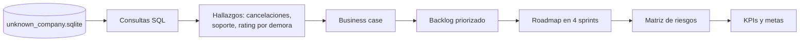

# Experiencia de entrega en un e-commerce: de SQL al backlog

Análisis con SQL de la base operativa de **Unknown Company**, una empresa de e-commerce y logística que estaba perdiendo clientes. Con los datos armamos el diagnóstico, un business case, un backlog priorizado, un roadmap por sprints y una matriz de riesgos.

> Trabajo grupal de Project Management y Business Analysis, Licenciatura en Negocios Digitales, Universidad ORT Uruguay, 2025.

## Qué encontramos

| Indicador | Resultado |
|---|---|
| Pedidos analizados | 12.000 |
| Pedidos cancelados | 1.406, un 11,72 %: 1 de cada 9 |
| Tiempo promedio de resolución en soporte | 318 horas, casi 13 días |
| Rating con entrega en menos de 3 días | más de 4 sobre 5 |
| Rating con entrega de más de una semana | 1,34 sobre 5 |

La puntualidad y la visibilidad del envío son lo que más pesa en la experiencia del cliente.

## Estructura del repo

```
ecommerce-entregas-sql/
├── sql/                       consultas del diagnóstico, una por pregunta
│   ├── 01_esquema_y_conteos_base.sql
│   ├── 02_cancelaciones_y_tasa_de_cancelacion.sql
│   ├── 03_tiempos_de_entrega_y_satisfaccion.sql
│   ├── 04_creacion_de_eta_y_envios_sin_eta.sql
│   ├── 05_on_time_delivery_otd.sql
│   ├── 06_fallas_de_entrega_y_motivos.sql
│   ├── 07_tiempo_de_resolucion_de_soporte.sql
│   ├── 08_devoluciones_volumen_importe_y_categoria.sql
│   └── 09_carritos_abandonados_proxy_via_sesiones.sql
├── data/README.md             tablas usadas y cómo conseguir la base
└── docs/
    ├── business_case.md       problema, causas, impacto y propuesta
    ├── backlog.md             requerimientos priorizados y dependencias
    └── roadmap_y_riesgos.md   sprints y matriz de riesgos
```

## Del dato a la decisión



## Cómo correrlo

1. Ubicá la base en `data/unknown_company.sqlite`.
2. Abrila con SQLite o con DB Browser for SQLite:
   ```bash
   sqlite3 data/unknown_company.sqlite
   ```
3. Corré los archivos de `sql/` en orden:
   ```sql
   .read sql/02_cancelaciones_y_tasa_de_cancelacion.sql
   ```

## Decisiones de diseño

- **Una consulta por pregunta de negocio**, numerada y explicada, para que cualquiera pueda reproducir cada cifra del informe.
- **Normalización de estados:** "cancelado" aparecía escrito de cinco formas distintas, así que unificamos todas las variantes antes de calcular la tasa.
- **ETA reconstruida:** la base no tenía fecha estimada de entrega, así que la estimamos con la duración histórica. Por eso el On-Time Delivery sale casi perfecto, y lo señalamos como un límite del análisis.
- **Carritos abandonados aproximados con sesiones:** no había un evento de carrito, así que usamos las sesiones como proxy.

## Metas propuestas

- 30 % menos cancelaciones en 90 días
- Soporte resuelto en 24 horas
- Rating post-entrega de 4 o más
- 15 % más recompra
- 25 % menos incidentes logísticos

## Stack

SQL (SQLite) · Notion · Trello · Miro · Scrum

---

**Romina Cor Castro** · [Portafolio](https://rominacor21.github.io) · [LinkedIn](https://www.linkedin.com/in/rominacor/)
